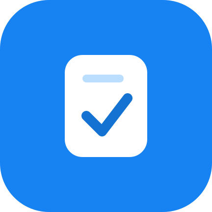
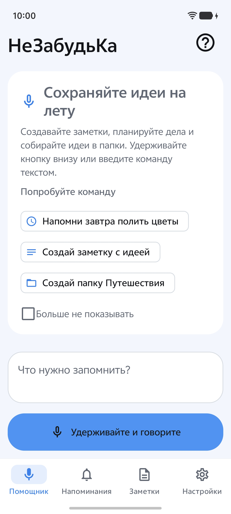
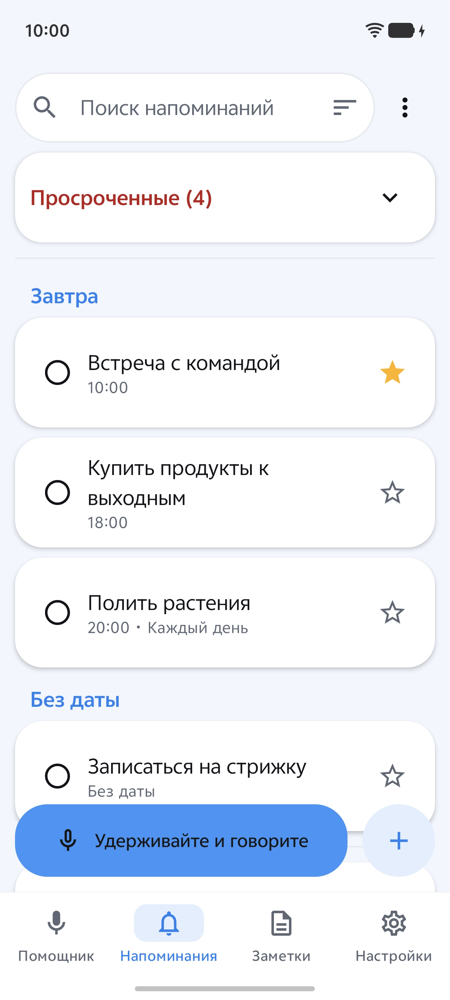
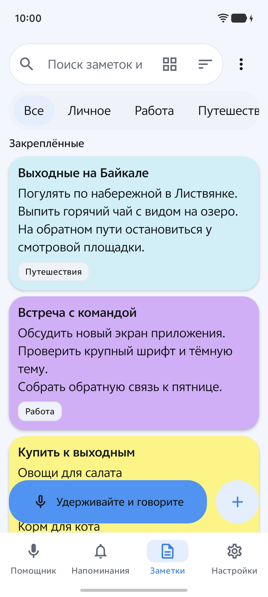
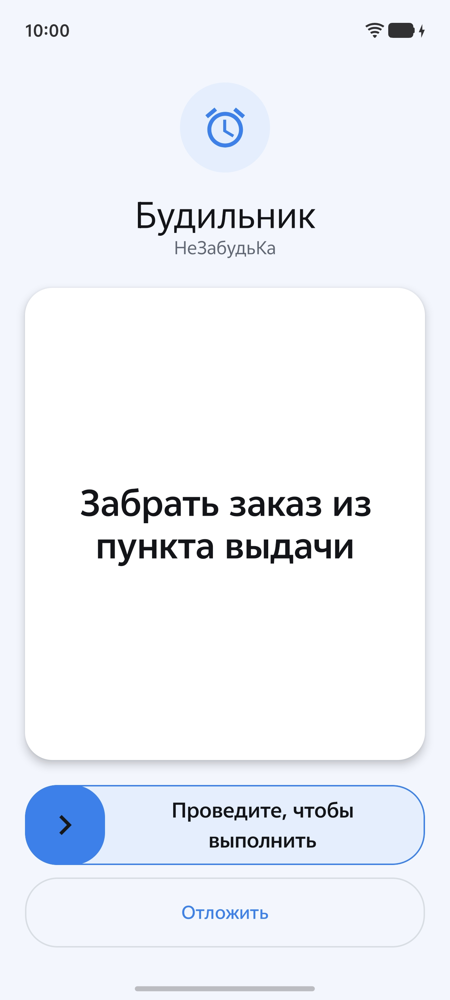
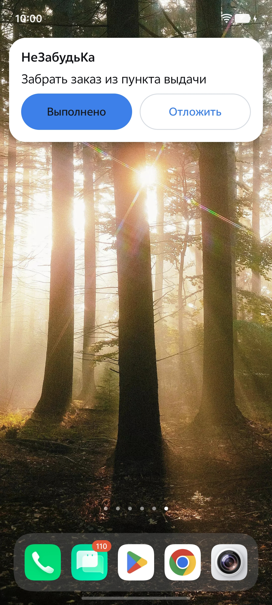
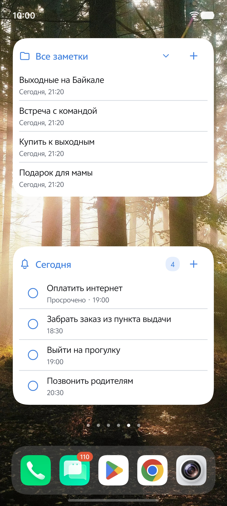
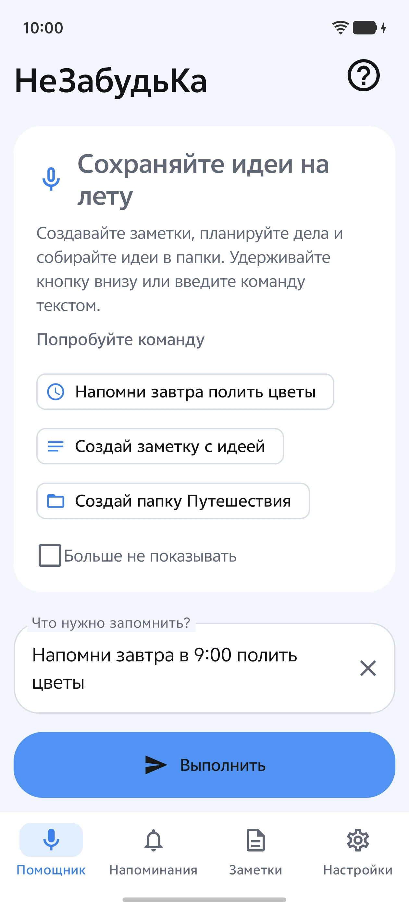
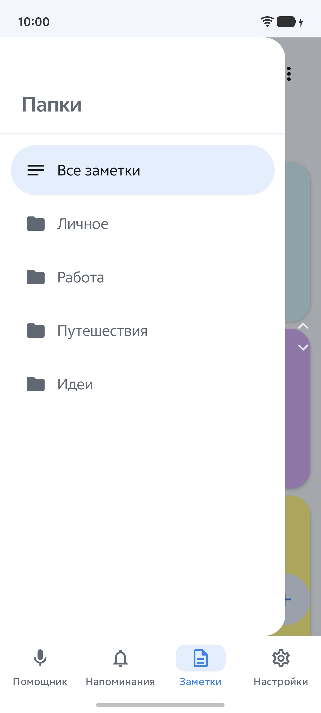
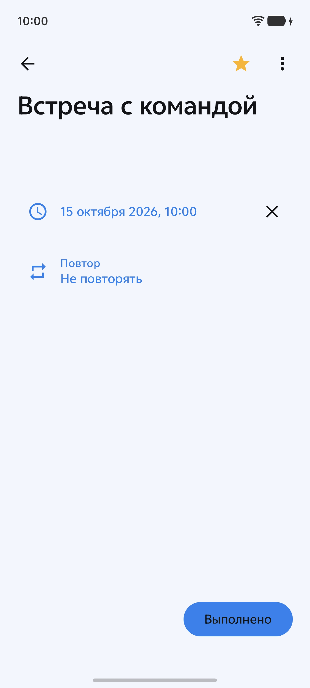

  

<h1 align="center">НеЗабудьКа</h1>

Заметки и напоминания для Android. Создавайте записи голосом или вводите текст вручную.

[Скачать приложение](https://github.com/NikitaRe99/NeZabudKa-Android/releases/latest) · [Модели для распознавания](https://github.com/NikitaRe99/NeZabudKa-Android/releases/tag/models-v3)

<table>
  <tr><th>Голосовой помощник</th><th>Напоминания</th><th>Заметки и папки</th></tr>
  <tr>
    <td></td>
    <td></td>
    <td></td>
  </tr>
</table>

## Что умеет приложение

**Голосовые команды.** Можно создать заметку, добавить напоминание или посмотреть дела на завтра. Распознанный текст можно исправить перед выполнением. Если это не нужно, включите выполнение команд сразу.

Например:

- «Напомни завтра в девять утра полить цветы»
- «Покажи напоминания на завтра»
- «В папку Путешествия добавь заметку взять зарядку»

**Заметки.** Папки, цветные карточки, закрепление, поиск, архив и корзина. Есть список и сетка. Заметки можно печатать или диктовать.

**Напоминания.** Разовые и повторяющиеся дела, избранное и записи без даты. Повторяющееся напоминание после выполнения переносится на следующую дату.

**Будильник.** Можно выбрать обычное уведомление или будильник с длительным сигналом. Доступны окно поверх приложений, показ на экране блокировки и кнопка «Отложить».
<table>
  <tr><th>Полноэкранный будильник</th><th>Компактное окно</th></tr>
  <tr>
    <td></td>
    <td></td>
  </tr>
</table>

**Виджеты.** Один показывает дела на сегодня и позволяет отмечать их выполненными. Другой открывает заметки и переключает папки.

  

**Оформление.** Светлая, тёмная и пользовательская темы. Можно выбрать цвета, шрифт и значок приложения.

## Распознавание речи

GigaAM и Whisper работают на телефоне без интернета после скачивания модели. Для GigaAM можно включить показ текста во время записи.

Также доступны системное распознавание Android и облачные сервисы Yandex, Google и VK. Для облачных сервисов нужны собственные ключи доступа.

При желании можно подключить модель пунктуации и NLU — модель для понимания свободных формулировок команд.

## Как начать

1. Установите приложение на **Android 10 или новее**. Для большинства современных телефонов подходит APK `arm64-v8a`.
2. В разделе **Настройки → Речь и команды** выберите способ распознавания и скачайте модель.
3. Для напоминаний проверьте разрешения в разделе **Настройки → Напоминания**. Там же можно проверить уведомление и будильник.

## Ваши данные

Заметки и напоминания хранятся на устройстве. Их можно сохранить в файлы и восстановить; точные дубликаты будут пропущены. При выборе GigaAM или Whisper звук не отправляется в облачный сервис.

  
Ещё скриншоты: команда, папки и редактирование напоминания

  <table>
    <tr><th>Проверка команды</th><th>Боковая панель папок</th><th>Редактор напоминания</th></tr>
    <tr>
      <td></td>
      <td></td>
      <td></td>
    </tr>
  </table>

## Для разработчиков

[Устройство проекта и сборка](docs/development.md) · [Демоверсия для скриншотов](docs/SCREENSHOTS_DEMO.md) · [Лицензия Apache 2.0](LICENSE) · [Лицензии моделей](MODEL_LICENSES.md)
